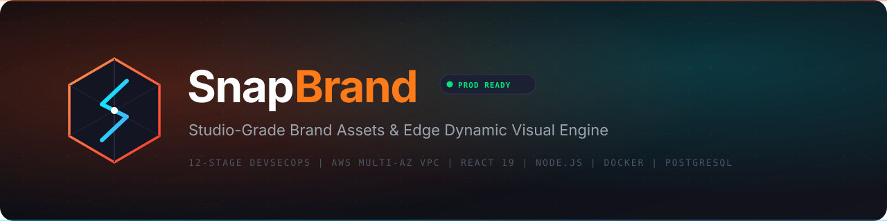
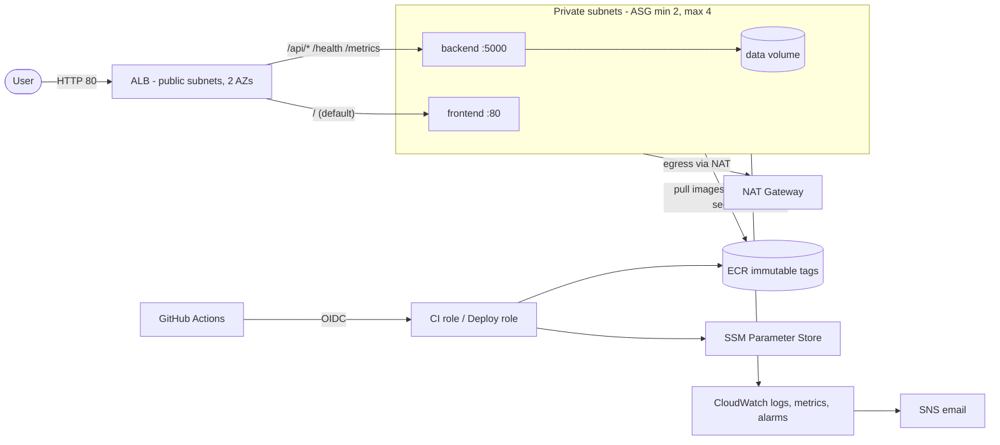

<p align="center">
  
</p>

# SnapBrand

SnapBrand is a small brand-asset studio: a React single-page app (frontend service) plus a Node.js/Express API (backend service) that renders dynamic OpenGraph/SVG cards and stores projects, brand kits and an audit trail in a file-backed storage layer on a persistent volume. The app is deliberately small; the focus of this repository is the **DevSecOps pipeline, high availability, scaling, observability and security** around it.

**Live link:** http://snapbrand-prod-alb-1271941775.ap-southeast-2.elb.amazonaws.com/

| Service | Tech | Port | Health endpoint |
|---|---|---|---|
| `frontend` | React 18 + Vite, served by nginx-unprivileged | 8080 (80 on the host) | `/healthz` |
| `backend` | Node 20 + Express + TypeScript | 5000 | `/health` (also `/metrics`) |
| storage | JSON file store on a Docker volume (`/app/data`) | n/a | reported in `/health` |

Each service has its own Dockerfile and is independently buildable and deployable. Note on the storage layer: data lives on a per-instance volume, so users created on one instance are not shared with another. That is an accepted trade-off for a small project; a managed database (RDS/DynamoDB) would be the next step.

---

## Architecture

The full diagram (AWS services, AZs, request flow, 12 pipeline stages, OIDC roles, secrets, monitoring) is in **[docs/ARCHITECTURE.md](docs/ARCHITECTURE.md)**.



## Repository layout

```
frontend/            React SPA, Dockerfile, nginx config
backend/             Express API, tests, Dockerfile
infra/cloudformation.yml   Complete AWS platform (VPC, ALB, ASG, ECR, IAM/OIDC, CloudWatch, budget)
docker-compose.yml         Local stack (builds images)
docker-compose.prod.yml    Production variant (ECR images, awslogs), published to SSM by the pipeline
scripts/                   Automation scripts (see below)
.github/workflows/         devsecops-ci.yml (12 stages), manual-rollback.yml
.github/dependabot.yml     Dependabot for npm, Docker and GitHub Actions
SECURITY.md                Security policy and documented exceptions
docs/                      Architecture, incident note, report, evidence checklist
```

## Run locally (one command)

```bash
cp .env.example .env            # optional: set JWT_SECRET
docker compose up -d --build
```

* Frontend: http://localhost:3000
* API health: http://localhost:5000/health  metrics: http://localhost:5000/metrics
* Demo login: `creator@snapbrand.io` / `password123` (seed data)

Stop: `docker compose down` (add `-v` to delete the data volume).

Without Docker: `npm --prefix backend ci && npm --prefix backend run dev`, and `npm --prefix frontend ci && npm --prefix frontend run dev`.

## Shell scripts

All scripts use `set -euo pipefail`, pass ShellCheck (pipeline stage 10) and are documented here.

| Script | Purpose | Called from |
|---|---|---|
| `scripts/run_checks.sh` | Local pre-PR gate: ShellCheck, Gitleaks, ESLint, tests, Hadolint | developers |
| `scripts/smoke_test.sh <url> [version]` | Post-deploy smoke test: `/health` (checks the expected version), API, render, frontend | **stage 12**, manual rollback workflow |
| `scripts/deploy.sh <tag>` | Verifies tag in ECR, writes tag + compose file to SSM, rolling ASG instance refresh, waits | **stage 11** |
| `scripts/rollback.sh <tag>` | Rolls the fleet back to a previous tag | **stage 12** (auto), manual rollback workflow |
| `scripts/deploy_stack.sh <email>` | Creates/updates the CloudFormation stack | operators |
| `scripts/teardown.sh --yes` | Deletes images, parameters and the stack | operators |
| `scripts/demo_failover.sh <url>` | Terminates an instance while polling the ALB (HA evidence) | operators |
| `scripts/incident_demo.sh inject\|fix` | Deliberate failure drill (see [docs/INCIDENT.md](docs/INCIDENT.md)) | operators |
| `scripts/load_test.js` | k6 load test for scale-out / scale-in | operators |

## CI/CD pipeline (12 stages)

Stages 1-10 run on every push and pull request; 11-12 run automatically on merge to `main`. Each stage is a separate job that needs the previous one, so a failure stops the pipeline.

| # | Job | Tool | Fails the build when |
|---|---|---|---|
| 01 | Secret Scan | Gitleaks (full history) | any secret is found |
| 02 | Code Linting | ESLint | any lint error |
| 03 | Code Formatting | Prettier | any unformatted file |
| 04 | Dockerfile Lint | Hadolint | warning or error |
| 05 | Unit Tests & Coverage | Vitest + v8 coverage | failing test (coverage uploaded as artifact) |
| 06 | Static Analysis | SonarCloud | quality gate fails (`qualitygate.wait=true`) |
| 07 | Dependency Scan | Snyk | any high or critical vulnerability |
| 08 | Docker Image Build | Buildx, multi-stage | build error |
| 09 | Container Scan | Trivy | any HIGH or CRITICAL CVE |
| 10 | Shell Scripting Gate | ShellCheck | any finding |
| 11 | CD Push & Rolling Deploy | ECR + SSM + ASG instance refresh | push or rollout fails (auto-rolls back) |
| 12 | Smoke Test & Auto-Rollback | `smoke_test.sh` | smoke test fails: rolls back to the previous tag, then fails the run |

No scanner is disabled and no threshold is lowered. Findings must be fixed or documented in [SECURITY.md](SECURITY.md).

**Versioning.** Every deployed image is tagged with the git commit SHA **and** a semantic version `v<VERSION file>.<run number>` (for example `v1.0.7`). ECR tag immutability is on; `latest` is never used.

**Rolling deployment.** `deploy.sh` publishes the tag to SSM `/snapbrand/image-tag` and starts an ASG instance refresh with `MinHealthyPercentage=50`: one instance is replaced at a time while the other keeps serving. New instances read the tag and the compose file from SSM at boot.

**Rollback.** Automatic (stage 12 failure, or stage 11 rollout failure) and manual: *Actions -> Manual Deployment Rollback -> Run workflow -> enter an image tag*.

### One-time GitHub setup

| Item | Where | Value |
|---|---|---|
| `SONAR_TOKEN` | Secrets | from SonarCloud (project key `jabeen-zahra_SnapBrand`, org `jabeen-zahra` in `sonar-project.properties`; adjust if different) |
| `SNYK_TOKEN` | Secrets | from Snyk account settings |
| `AWS_CI_ROLE_ARN`, `AWS_DEPLOY_ROLE_ARN`, `ALB_URL` | Variables | stack outputs (defaults for this account are built into the workflow) |

No AWS access keys are stored anywhere: the pipeline uses GitHub OIDC.

### Branching strategy and branch protection

* `main` is protected by a ruleset: direct pushes blocked, pull request with **at least one approving review** required, force-push and deletion blocked, and **all ten CI jobs are required status checks**: `01. Secret Scan (Gitleaks)`, `02. Code Linting (ESLint)`, `03. Code Formatting (Prettier)`, `04. Dockerfile Lint (Hadolint)`, `05. Unit Tests & Coverage`, `06. Static Analysis (SonarCloud)`, `07. Dependency Scan (Snyk)`, `08. Docker Image Build`, `09. Container Scan (Trivy)`, `10. Shell Scripting Gate (ShellCheck)`.
* Work happens on `feature/<name>` or `fix/<name>` branches, merged through pull requests reviewed by another group member.

## Deploy from scratch on AWS (region ap-southeast-2)

Prerequisites: AWS CLI v2 configured with an admin-capable identity, the repository on GitHub.

1. **Create the platform** (VPC, ALB, ASG, ECR, IAM roles + OIDC provider, secret, alarms, dashboard, budget):
   ```bash
   ./scripts/deploy_stack.sh you@example.com            # add: false <existing-oidc-arn> if the GitHub OIDC provider already exists
   ```
   Confirm the SNS subscription email that AWS sends.
2. **Set GitHub values** (section above): `SONAR_TOKEN`, `SNYK_TOKEN`, optional role/URL variables.
3. **Deploy**: merge a pull request to `main`. Stage 11 builds and pushes both images, publishes the release to SSM and rolls the fleet; stage 12 smoke-tests the ALB. Instances stay unhealthy until the first release is published.
4. Open the `LoadBalancerDNS` output in a browser.

### Every configuration choice (so it can be rebuilt by hand)

**Network (`infra/cloudformation.yml`)**

| Resource | Setting | Why |
|---|---|---|
| VPC | `10.0.0.0/16`, DNS hostnames on | Room for many /24 subnets |
| Public subnets | `10.0.1.0/24` (AZ a), `10.0.2.0/24` (AZ b); route `0.0.0.0/0 -> Internet Gateway` | Only the ALB and NAT live here |
| Private subnets | `10.0.10.0/24` (AZ a), `10.0.20.0/24` (AZ b); route `0.0.0.0/0 -> NAT Gateway` | Instances have no public IP and are unreachable from the internet |
| NAT Gateway | One, in public subnet A | Lets private instances reach ECR, SSM and GitHub. One NAT keeps cost low; one per AZ would remove this single point of failure |
| ALB SG | inbound TCP 80 from `0.0.0.0/0` | Public entry point |
| Instance SG | inbound TCP 80 and 5000 **only from the ALB SG**; no port 22 | Instances accept traffic only from the load balancer; management is via SSM Session Manager |

**Load balancer.** Internet-facing ALB across both public subnets. Listener `:80` default action forwards to the **frontend target group** (port 80, health check `/healthz`); a listener rule (priority 10) forwards `/api/*`, `/health`, `/metrics` to the **backend target group** (port 5000, health check `/health`, expects 200). Health check interval 15 s, healthy 2, unhealthy 3, deregistration delay 30 s.

**Launch template.** Amazon Linux 2023 (SSM-resolved latest AMI), `t3.micro`, 12 GB encrypted gp3, IMDSv2 required, instance profile `snapbrand-prod-instance-profile`, no key pair. User data installs Docker + Compose + the CloudWatch agent, then a systemd unit reads `/snapbrand/image-tag`, `/snapbrand/compose` (SSM) and the JWT secret (Secrets Manager), logs in to ECR and runs `docker compose up -d` with `docker-compose.prod.yml`.

**Auto Scaling Group.** Private subnets in both AZs, min 2 / desired 2 / max 4, health check type ELB (grace 300 s), registered with both target groups. Scaling policies (target tracking): average CPU 60 percent, and ALB request count per target 300 per minute.

**ECR.** `snapbrand-frontend` and `snapbrand-backend`, `ImageTagMutability=IMMUTABLE`, scan on push.

**IAM (least privilege, three separate roles).**

| Role | Used by | Permissions |
|---|---|---|
| `snapbrand-prod-instance-role` | EC2 instances | SSM core (Session Manager), ECR read-only, CloudWatch agent, `ssm:GetParameter` on `/snapbrand/*`, `secretsmanager:GetSecretValue` on the JWT secret |
| `snapbrand-prod-ci-role` | GitHub Actions (stage 11 push) | ECR push to the two repositories only |
| `snapbrand-prod-deploy-role` | GitHub Actions (stage 11/12, rollback) | read/write `/snapbrand/*` parameters, start/cancel instance refresh on this ASG, describe ASG/refresh/target health, `ecr:DescribeImages` |

Both GitHub roles trust only the GitHub OIDC provider with `aud=sts.amazonaws.com` and `sub=repo:jabeen-zahra/SnapBrand:ref:refs/heads/main`. Secrets: JWT secret in **AWS Secrets Manager** (generated, never in git), release config in **SSM Parameter Store**, CI tokens in **GitHub Secrets**.

**Observability.** CloudWatch dashboard `snapbrand-prod-overview` (request rate, 4xx/5xx errors, p95 and average latency, CPU and memory, target health, ASG capacity, backend log table); log groups `/snapbrand/backend` and `/snapbrand/frontend` fed by the Docker `awslogs` driver; four alarms (high CPU, unhealthy targets, ELB 5xx, high latency) notifying an SNS topic with an email subscription; AWS Budget at 80 percent of the monthly limit.

## Network design and service discovery

* **Public vs private:** only the ALB and NAT gateway are in public subnets. The application runs in private subnets, so there is no inbound path except ALB -> instance on ports 80/5000.
* **How a request flows:** browser -> ALB (HTTP 80) -> path rule: `/api/*`, `/health`, `/metrics` go to the backend target group, everything else to the frontend target group -> container on the instance.
* **Service-to-service:** inside an instance, both containers share the Docker Compose network `snapbrand-net`; nginx in the frontend container proxies `/api` to `http://backend:5000` using Docker DNS. Locally the same compose network is used.
* **Egress:** private instances reach ECR, SSM and package mirrors through the NAT gateway.

## Failure tolerance, scaling and incident evidence

```bash
./scripts/demo_failover.sh http://<ALB_DNS> 300      # terminate an instance while the app is polled
k6 run -e TARGET_URL=http://<ALB_DNS> scripts/load_test.js   # scale-out then scale-in
./scripts/incident_demo.sh inject                    # deliberate failure; later: ./scripts/incident_demo.sh fix
```

Evidence to capture (CloudWatch metrics, ASG activity history, alarm email) is listed in [docs/EVIDENCE_CHECKLIST.md](docs/EVIDENCE_CHECKLIST.md). Post-incident note: [docs/INCIDENT.md](docs/INCIDENT.md).

## Tear everything down

```bash
./scripts/teardown.sh --yes     # deletes ECR images, SSM parameters and the whole CloudFormation stack
```

## Team

| Member | GitHub | Ownership |
|---|---|---|
| Jabeen Zahra | `jabeen-zahra` | Frontend, application architecture, AWS console work, repository admin |
| Mirfaq Javaid | `Mirfaq` | Backend service, Dockerfiles, tests, pull-request review |
| Fatima Ijaz | `Fatima-Ijaz` | CI/CD pipeline, security tooling, cloud infrastructure |

(Final contribution table with roll numbers: [docs/REPORT.md](docs/REPORT.md).)

## License

MIT, see [LICENSE](LICENSE).
