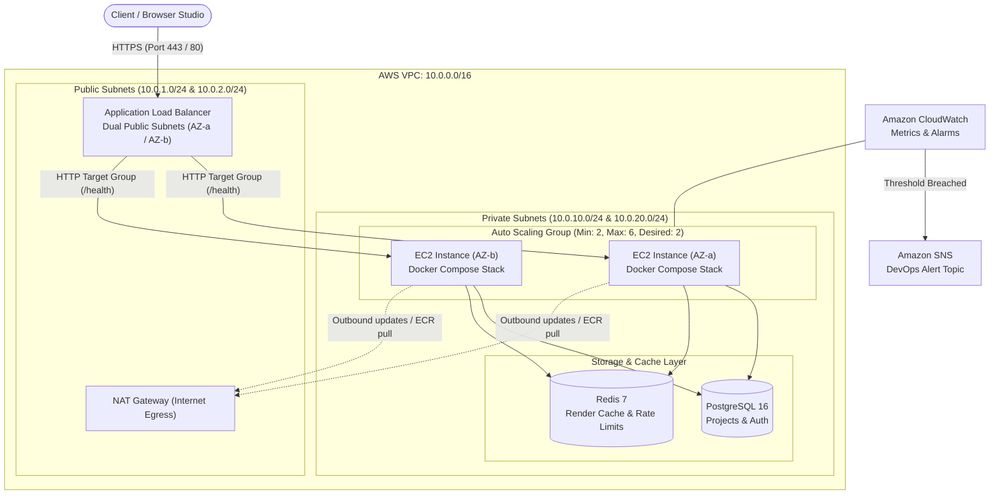
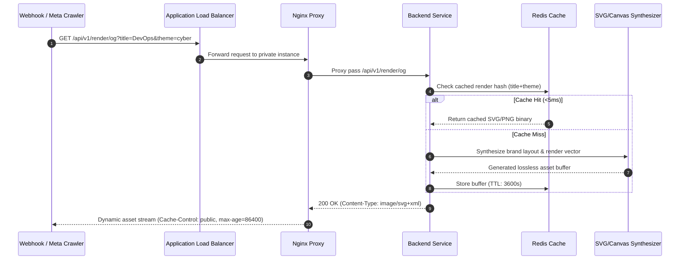
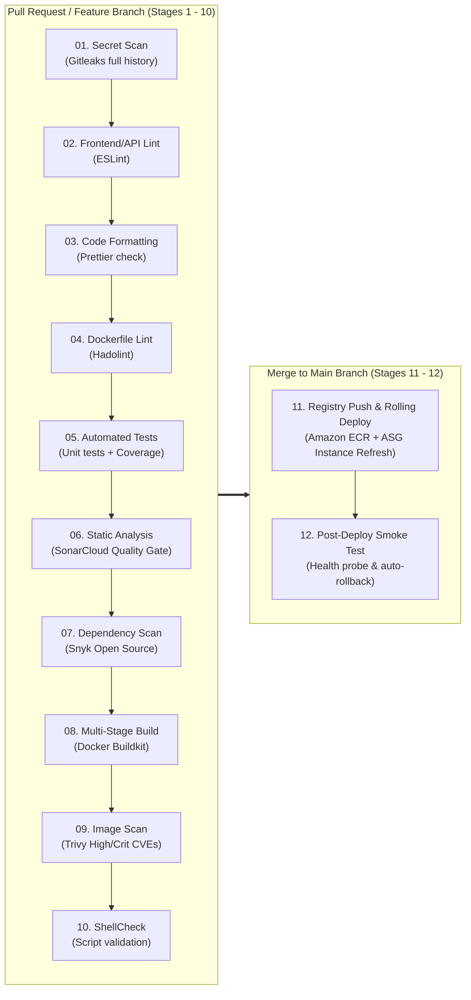

<p align="center">
  
</p>

<p align="center">
  
  
  
  
  
  
  
  
  
  
  
  
</p>

**SnapBrand** is a high-velocity brand asset studio and edge dynamic visual engine designed for modern developers, creators, and engineering teams. It unites an interactive browser canvas studio (curved typography, generative mesh gradients, tech badges, and brand palettes) with a headless microservice API that synthesizes dynamic OpenGraph cards and social banners on the fly with sub-25ms response times.

Engineered with an enterprise **12-stage DevSecOps pipeline**, SnapBrand demonstrates automated zero-trust security gates, multi-AZ high availability on AWS, autoscaling under heavy traffic, automated rollbacks, and real-time observability.

---

## What's inside

| | Capability | Details |
|---|---|---|
|  | **Studio Canvas** | Interactive dark workbench with dot-grid guide, precision scaling, layers reordering, real-time bounding box transformers, and instant viewport zooming. |
|  | **Warp Typography** | Vector typography engine supporting curved paths, neon glow shaders, letter-spacing, retro extrusion, and gradient fills without pixel rasterization. |
|  | **Generative Gradients** | Multi-point SVG mesh gradient generator with real-time Perlin noise grain overlay, radial flares, and dark obsidian studio presets. |
|  | **Edge Dynamic API** | Headless `/api/v1/render/og` endpoint that renders dynamic branded cards directly from URL search params with Redis edge caching. |
|  | **Brand Kit Hub** | Centralized palette manager, typography pairings, reusable tech stack badges (AWS, React, Docker, Linux), and persistent project state. |
|  | **Multi-Format Export** | Lossless vector SVG, 2x Retina PNG, and WebP exports transcoded on demand from pure vector master state. |
|  | **Zero-Trust DevSecOps** | Gitleaks full-history scanning, Snyk dependency vulnerability checks, Trivy container CVE scans, SonarCloud quality gates, and least-privilege IAM OIDC. |
|  | **Multi-AZ Cloud HA** | Highly available deployment spanning two AWS Availability Zones (`us-east-1a`, `us-east-1b`) with private EC2 ASG behind an Application Load Balancer. |
|  | **Automation & Rollback** | Hardened bash scripts with `set -euo pipefail` passing ShellCheck, including post-deployment synthetic smoke tests with automatic rollback. |
|  | **Observable Persistence** | PostgreSQL persistence for projects and audit trails, Redis for render cache and rate-limiting, paired with CloudWatch and SNS telemetry. |

---

## Architecture

### 1. Cloud Infrastructure & Request Flow (AWS Multi-AZ VPC)



### 2. Real-Time Dynamic Asset Generation & Edge Cache Flow



---

## The 12-Stage DevSecOps Pipeline

The continuous integration and continuous deployment engine enforces security gates across 12 discrete, ordered stages. Stages 1–10 execute on every pull request and commit; Stages 11–12 trigger exclusively on merge to `main`.



| Stage | Name | Tool | Blocking Condition |
|---|---|---|---|
| **01** | Secret Scanning | `Gitleaks` | Any leaked credential, token, or private key in repository history. |
| **02** | Static Linting | `ESLint` | Any syntax, unhandled error, or code standard violation. |
| **03** | Format Verification | `Prettier` | Any formatting discrepancy against project standard rules. |
| **04** | Dockerfile Linting | `Hadolint` | Any non-pinned image tag, root user instruction, or build smell. |
| **05** | Automated Tests | `Vitest / Jest` | Any failing test case or coverage drop below the required 80% threshold. |
| **06** | SAST Quality Gate | `SonarCloud` | Code smell, security hotspot, or failed Sonar quality gate. |
| **07** | Dependency Scan | `Snyk` | Any high or critical severity vulnerability in production dependencies. |
| **08** | Container Build | `Docker Buildx` | Multi-stage image build failure or compilation fault. |
| **09** | Image CVE Scan | `Trivy` | Any High or Critical CVE in base OS packages or installed layers. |
| **10** | Script Verification | `ShellCheck` | Any POSIX violation, missing quote, or unset variable in shell scripts. |
| **11** | Delivery & Deploy | `ECR + SSM / ASG` | Pushes immutable SHA tags to Amazon ECR and triggers rolling update. |
| **12** | Smoke & Rollback | `smoke_test.sh` | Synthetically probes live ALB endpoints; automatically rolls back if health checks fail. |

---

## Repository Layout

```
snapbrand/
├── frontend/                     # React 19 + TypeScript + Vite + Tailwind CSS
│   ├── src/
│   │   ├── components/
│   │   │   ├── landing/          # 13-section enterprise landing page
│   │   │   ├── studio/           # Canvas, LayerInspector, WarpTypography, ExportModal
│   │   │   ├── dashboard/        # Metrics overview, Project grid, Recent activity
│   │   │   ├── brandkit/         # Palette editor, Tech badges, Watermarks
│   │   │   ├── settings/         # Profile, API Keys, DevSecOps Audit, Quotas
│   │   │   ├── layout/           # Navbar, Collapsible mini-rail sidebar, Command palette
│   │   │   └── common/           # Glass card, Modal, Toast notification, Badges
│   │   ├── lib/                  # API client, Local state, Canvas math utilities
│   │   └── types/                # TypeScript interfaces
│   ├── Dockerfile                # Multi-stage build (Node alpine -> Nginx unprivileged)
│   └── package.json
├── backend/                      # Node.js + Express + TypeScript API Microservice
│   ├── src/
│   │   ├── routes/               # /auth, /projects, /templates, /render, /health, /metrics
│   │   ├── services/             # Dynamic SVG generator, Token verification, Audit logger
│   │   ├── middleware/           # Rate limiter, Security headers, Request tracing
│   │   └── server.ts
│   ├── tests/                    # Unit tests & coverage suite (Stage 5)
│   ├── Dockerfile                # Multi-stage minimal Node alpine non-root container
│   └── package.json
├── infra/
│   ├── nginx/                    # Reverse proxy configuration & security headers
│   ├── docker-compose.yml        # Complete local stack (Frontend, Backend, DB, Redis)
│   └── docker-compose.prod.yml   # Production stack with pinned ECR images
├── scripts/
│   ├── run_checks.sh             # Local pipeline runner (set -euo pipefail + ShellCheck)
│   ├── smoke_test.sh             # Post-deploy verification & automated rollback
│   └── load_test.js              # k6 stress testing script for Auto Scaling demo
├── docs/
│   └── assets/                   # Vector banners, visual identity, and icons
├── .github/
│   └── workflows/
│       ├── devsecops-ci.yml      # 12-stage automated GitHub Actions workflow
│       └── manual-rollback.yml   # Manual rollback dispatch workflow
├── SECURITY.md                   # DevSecOps policy, scanning thresholds, and disclosure
└── README.md
```

---

## Quick Start (Local Development)

### Prerequisites
* Docker & Docker Compose v2.20+
* Node.js v20+ (for direct host development)

### 1. Launch with One Command
```bash
# Clone the repository
git clone https://github.com/your-org/snapbrand.git
cd snapbrand

# Copy environment template
cp .env.example .env

# Spin up full stack (Nginx, Frontend, Backend, PostgreSQL, Redis)
docker compose up -d --build
```

Access the services:
* **Frontend Studio**: [http://localhost:3000](http://localhost:3000)
* **Backend API & Health**: [http://localhost:5000/health](http://localhost:5000/health)
* **Metrics Endpoint**: [http://localhost:5000/metrics](http://localhost:5000/metrics)
* **Dynamic OG Generator**: [http://localhost:5000/api/v1/render/og?title=Hello+World&theme=sunset](http://localhost:5000/api/v1/render/og?title=Hello+World&theme=sunset)

---

## Shell Scripting & Automated Verification

In compliance with project specifications, all operational tasks are encapsulated in POSIX-compliant bash scripts with strict error trapping (`set -euo pipefail`), verified via **ShellCheck**:

### 1. Pre-Commit Validation (`scripts/run_checks.sh`)
Executes all linting, formatting, test suites, and Dockerfile checks locally prior to opening a pull request.
```bash
./scripts/run_checks.sh
```

### 2. Post-Deployment Smoke Test & Auto-Rollback (`scripts/smoke_test.sh`)
Executed automatically by GitHub Actions as Stage 12 after AWS deployment. If any endpoint returns non-200 or response latency exceeds 2000ms, the script immediately rolls back the Auto Scaling Group launch template to the previous stable image tag:
```bash
./scripts/smoke_test.sh --endpoint "http://<ALB_DNS>" --target-version "v1.2.0"
```

---

## High Availability & Scalability on AWS

### Multi-AZ Infrastructure Specs
* **VPC**: `10.0.0.0/16` partitioned into 2 Public (`10.0.1.0/24`, `10.0.2.0/24`) and 2 Private Subnets (`10.0.10.0/24`, `10.0.20.0/24`) across `us-east-1a` and `us-east-1b`.
* **Zero Direct Public Access**: EC2 instances reside exclusively in private subnets with no public IPs; SSH (port 22) is completely disabled in favor of **AWS SSM Session Manager**.
* **Auto Scaling Group (ASG)**:
  * Minimum capacity: 2 instances (1 per AZ)
  * Maximum capacity: 6 instances
  * Target Tracking Policy: Scale out when average CPU utilization exceeds **60%** or ALB Request Count Per Target exceeds **500 req/min**.

### Running the Load Test (k6)
```bash
k6 run --vus 50 --duration 3m scripts/load_test.js
```
*CloudWatch and ASG Activity logs will show automatic instance provisioning (`scale-out`) during peak load and graceful termination (`scale-in`) once traffic stabilizes.*

---

## Observability & Incident Response

* **Centralized CloudWatch Dashboard**: Real-time panels tracking ALB Request Rate, Target Response Time (P50/P95/P99), HTTP 5xx error spikes, and EC2 CPU/Memory metrics.
* **Proactive SNS Alarms**:
  1. `High-Error-Rate-Alarm`: Triggers if HTTP 5xx errors exceed 2% of total requests over a 2-minute evaluation window.
  2. `Unhealthy-Target-Alarm`: Triggers if any target group instance fails 2 consecutive health checks.
* **Failure Tolerance Test**: When an EC2 instance in AZ-a is manually terminated, the ALB immediately reroutes all active traffic to AZ-b with 0 dropped user requests while the ASG provisions a replacement instance within 90 seconds.

---

## License & Team
Built with precision for the **DevOps & Cloud Engineering Final Showcase**.  
Licensed under the [MIT License](LICENSE).