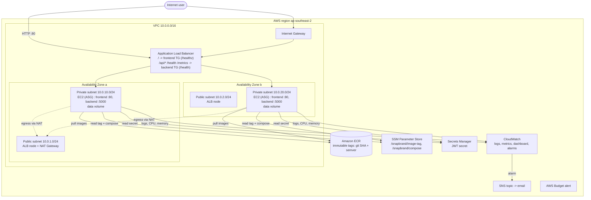

# SnapBrand Architecture

## 1. AWS runtime architecture (request flow)

Instances are reachable only from the ALB security group. SSH is closed; operators use SSM Session Manager.

## 2. CI/CD pipeline and trust (12 stages, OIDC, secrets)

```mermaid
flowchart LR
  Dev[Developer] -->|feature branch + PR, 1 review| GH[GitHub repo<br/>protected main]
  subgraph CI["Stages 1-10: every push and PR (GitHub Actions)"]
    direction LR
    S1[01 Gitleaks] --> S2[02 ESLint] --> S3[03 Prettier] --> S4[04 Hadolint] --> S5[05 Tests+coverage]
    S5 --> S6[06 SonarCloud] --> S7[07 Snyk] --> S8[08 Docker build] --> S9[09 Trivy] --> S10[10 ShellCheck]
  end
  GH --> CI
  CI -->|merge to main| S11
  subgraph CD["Stages 11-12: merge to main"]
    S11["11 Push to ECR (CI role)<br/>+ rolling deploy (Deploy role)"] --> S12["12 Smoke test via ALB<br/>auto-rollback on failure"]
  end
  GHS[(GitHub Secrets<br/>SONAR_TOKEN, SNYK_TOKEN)] -.-> CI
  S11 -->|"OIDC: AssumeRoleWithWebIdentity<br/>sub = repo:jabeen-zahra/SnapBrand:ref:refs/heads/main"| IAM["IAM: CI role (ECR push)<br/>Deploy role (SSM + ASG refresh)"]
  IAM --> ECR[(ECR)]
  IAM --> SSM[SSM parameters] --> ASG["ASG instance refresh<br/>min 50% healthy"] --> EC2[Private EC2 instances]
  S12 -->|curl /health, /api, /| ALB[ALB]
```

Release mechanism: stage 11 writes the new tag to SSM and starts an ASG instance refresh. Each new instance reads the tag and compose file from SSM, pulls the images from ECR and starts the stack. Rolling back is the same operation with the previous tag.

## 3. Monitoring and logging

* Container logs (`awslogs` driver) go to `/snapbrand/backend` and `/snapbrand/frontend`.
* The CloudWatch agent publishes memory and disk metrics; ALB and ASG publish request, error, latency, health and capacity metrics.
* Dashboard `snapbrand-prod-overview` shows request rate, errors, latency, CPU and memory.
* Alarms (high CPU, unhealthy targets, ELB 5xx, high latency) notify an SNS topic that emails the team. An AWS Budget alert covers cost.
